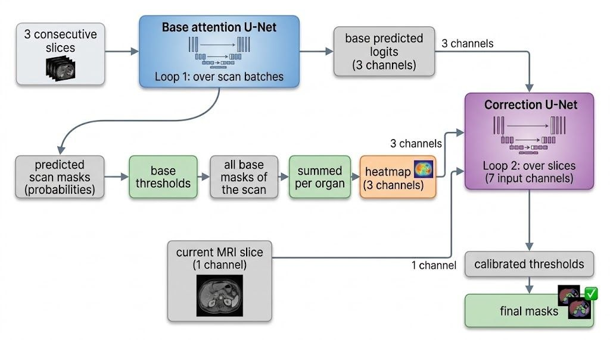
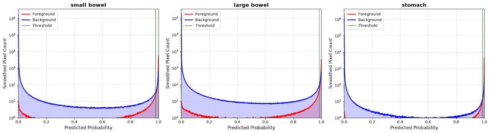
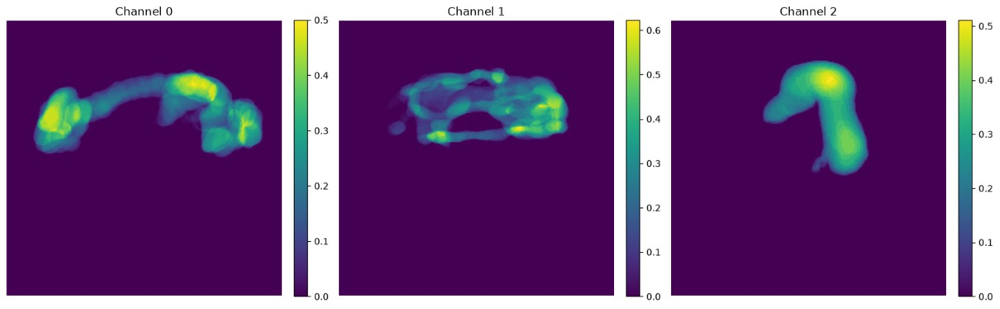
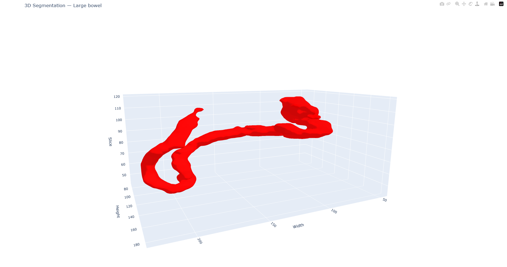
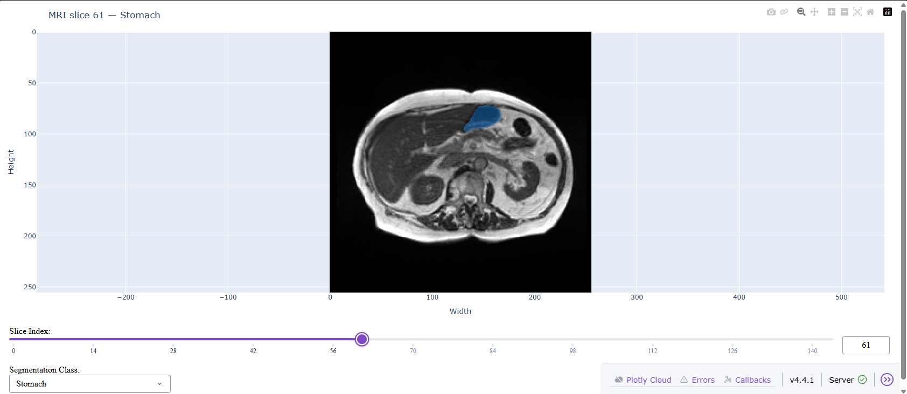

# MRI Gastrointestinal Tract Segmentation

A two-stage deep learning pipeline that localizes the **large bowel**, **small bowel** and **stomach** on abdominal MRI scans. Built with PyTorch Lightning, tracked with MLflow, DVC and Git, and designed to run on a laptop, on Kaggle GPUs and on Kaggle TPUs.

- Experiment tracking and data: [DagsHub](https://dagshub.com/Vital-ar/MRI-segmentation-project)
- Source code: [GitHub](https://github.com/Vital-ar/MRI-segmentation-project)
- Kaggle project notebooks and datasets: [Kaggle](https://www.kaggle.com/vitaliilavryk/)

---

## Table of contents

1. [Overview](#overview)
2. [Approach in brief](#approach-in-brief)
3. [Results](#results)
4. [Data](#data)
5. [Model architecture](#model-architecture)
6. [Loss function](#loss-function)
7. [Hyperparameter search](#hyperparameter-search)
8. [Final hyperparameters](#final-hyperparameters)
9. [Threshold calibration](#threshold-calibration)
10. [Inference and visualization](#inference-and-visualization)
11. [Project structure and engineering practices](#project-structure-and-engineering-practices)
12. [Engineering challenges](#engineering-challenges)
13. [Limitations and future work](#limitations-and-future-work)

---

## Overview

The project solves the task defined by the **UW-Madison GI Tract Image Segmentation** dataset: given MRI slices of a patient's abdomen, mark the pixels that belong to the large bowel, the small bowel and the stomach. Precise segmentation of these organs is the basis for planning radiation therapy, where the beam has to be aimed at a tumor while sparing healthy gastrointestinal tissue.

The project was built as a learning exercise. The goal was to create something with many different moving parts and to implement almost everything from scratch, with very little help from AI tools. You will find dozens of interesting functions and modules while explorint this projects files. It covers csv and MRI Image data preprocessing, tools to make training efficient, a flexible attention U-Net, a custom loss, a hyperparameter search, multi-accelerator training (CPU, multi-GPU, TPU), probability threshold calibration, a second-stage error correction model, and an interactive inference tool.

## Approach in brief

**Stage 1: base model.** A highly configurable 2.5D attention U-Net. It receives three consecutive MRI slices stacked as channels and predicts a three-channel mask (one channel per organ) for the middle slice. Because it only sees three slices, it knows nothing about the rest of the scan, which can lead to slice-to-slice inconsistencies.

**Stage 2: error correction model.** A smaller attention U-Net that receives the current MRI slice, the base model's mask for that slice, and a volume-level heatmap built from the base model's masks over the whole scan. It predicts a residual that is added to the base model's output. The idea is to bring information from the entire scan to a model that otherwise sees only a thin neighbourhood.

Both stages use **class-specific probability thresholds calibrated to maximize F1** instead of the default 0.5.




## Results

Evaluation was done on a held-out test set that was used **only once, for the final evaluation**. Neither the base model nor the correction model has seen it. It contains 4 patient cases, 11 MRI scans of 144 slices each, which gives **1584 test slices**.

F1 is computed globally at the pixel level: true positives, false positives and false negatives are accumulated over all batches of the test dataloader, and F1 is calculated once at the end (for binary masks this is equivalent to the Dice coefficient). Metrics were produced in `exploratory/final_metric.ipynb`.

| Model | Large bowel F1 | Small bowel F1 | Stomach F1 |
|---|---|---|---|
| Base model | 0.7145 | 0.6306 | 0.8936 |
| Base model + error correction | **0.7226** | **0.6432** | **0.8969** |
| Difference | +0.0081 | +0.0126 | +0.0033 |

Calibrated thresholds (large bowel, small bowel, stomach):

| Model | Thresholds |
|---|---|
| Base model | 0.98340, 0.97355, 0.96672 |
| Error correction model | 0.97866, 0.98422, 0.98606 |

The correction stage gives a small but consistent improvement on all three organs. The gain is modest. The test set contains 1584 slices but only 4 patients, and each configuration was evaluated in a single run, so the differences should be read as indicative rather than statistically established.

### Iterating the correction model

I also tried applying the correction model repeatedly, recomputing the heatmap and logits from its own output each time. This made results worse:

| Passes through the correction model | Large bowel F1 | Small bowel F1 | Stomach F1 |
|---|---|---|---|
| 1 (final design) | 0.7226 | 0.6432 | 0.8969 |
| 2 | 0.7195 | 0.6294 | 0.8938 |
| 3 | 0.7058 | 0.6138 | 0.8882 |

This suggests that repeated correction compounds the model's own errors, so a single pass is the right design.

### About the high thresholds

The optimal thresholds are very high (roughly 0.97 to 0.99). The probability histograms from `exploratory/f1_score_weights.ipynb` show that most pixels are pushed to the extremes, and the positively weighted BCE term in the loss likely raises predicted probabilities for foreground pixels, which would explain why a threshold far above 0.5 is optimal.



## Data

**Dataset:** UW-Madison GI Tract Image Segmentation (Kaggle). It contains 273 MRI scans from roughly 85 individual cases. Labels are provided as run-length-encoded strings, which are decoded and precomputed as `.npy` masks to save training time on limited Kaggle GPU and TPU quota.

**Split:** the data is split **by case, not by slice**, so slices of one patient never appear in more than one subset.

| Subset | Cases | Scans |
|---|---|---|
| Test | 4 | 11 |
| Dev | 4 | 12 |
| Train | remaining cases | remaining scans |

**Empty slices:** most slices at the top and bottom of a scan contain none of the target organs. A configurable fraction of such slices (`empty_mri_ratio`) is kept in the training set, the slices in this fraction change dynamically at every train epoch end. This fraction is one of the tuned hyperparameters, and the final models use 0.1.

**Why three slices?** The base model uses three consecutive slices as input. Larger context windows were not tried, because memory usage was already a bottleneck with three slices.

## Model architecture

### Base model: `MRIFlexAttentionUNet`

A flexible U-Net with attention gates on the skip connections. The following are configurable:

- the number of output channels of the first convolution
- the depth (number of encoder and decoder blocks)
- the number of convolutional layers in encoder and decoder blocks
- the kernel size of each block
- the normalization type (BatchNorm2d or GroupNorm)

**GroupNorm on TPUs.** TPU training required a batch size of 1 per device. Without synchronized batch statistics, BatchNorm2d produces very noisy statistics at such small batches. GroupNorm does not depend on the batch size, and replacing BatchNorm2d with it solved the problem.

### Correction model: `CorrectionModel`

A wrapper around a smaller `MRIFlexAttentionUNet`. Its input is a tuple of:

1. the current MRI slice (1 channel)
2. the base model's mask for that slice (3 channels)
3. the heatmap of the whole scan (3 channels)

These are concatenated into 7 input channels. The output of the network is **added to the base model's mask** for the current slice, so the network learns a correction instead of a full re-prediction.

### The heatmap

The heatmap is the sum of the binary base-model masks over all slices of one scan, computed separately for each organ channel. It carries volume-level information at the cost of only one extra input map per organ.

<!-- Image: heatmap for the three organ channels -->


PCA over the slice axis was considered and rejected. For binary masks it would largely reproduce the same mean-mask information while adding computational overhead and complexity.

## Loss function

`DiceBCELoss` combines two terms:

- `BCEWithLogitsLoss` with per-class positive weights, which compensate for the heavy imbalance between foreground and background pixels
- a Dice loss term

The positive weights were calculated from the ratio of labeled pixels to empty pixels at train set masks analysis in `exploratory/optuna_exp.ipynb`.
This loss function was considered after failure of `BCEWithLogitsLoss` on Optuna hyperparameter search. 

## Hyperparameter search

The search proceeded in three phases.

**1. Optuna search.** About 40 combinations, each trained for 3 epochs on 2 T4 GPUs on Kaggle. The objective was the validation loss. The search space included:

- output channels of the first convolution (explored values: 32, 64)
- depth (explored values: 3 and 4)
- number of convolutions per encoder and decoder block (explored range: 1 to 3)
- kernel size of each block (explored values: 3 and 5)
- AdamW learning rate (roughly 2e-4 to 6e-3) and weight decay
- the fraction of empty slices (explored range: 0.1 to 0.3)

The study was run in several Kaggle sessions because of the 12-hour session limit.

<!-- Image: Optuna parallel coordinate plot -->


**2. Manual search.** About 10 further experiments informed by the Optuna results, trained for up to 40 epochs with early stopping on 8 Kaggle TPUs, using GroupNorm or on 2 Kaggle GPUs using Batchnorm and checkpoits from Optuna search. Configurations are selected by index: an index equal to the rank in the sorted Optuna database loads the corresponding Optuna trial, while a specific four or five digit index marks a manual, non-Optuna configuration.

**3. Final training.** The selected configuration is trained for 5 additional epochs on train plus dev data.

## Final hyperparameters

| Parameter | Base model | Correction model |
|---|---|---|
| Epochs | 38 | 6 |
| Input channels | 3 (three slices) | 7 (slice + base mask + heatmap) |
| Output classes | 3 | 3 |
| First convolution output channels | 64 | 32 |
| Depth | 4 | 3 |
| Convolutions per encoder block | 2 | 2 |
| Convolutions per decoder block | 2 | 2 |
| Kernel sizes | [5, 3, 3, 5, 3, 5, 5, 3] | 3 |
| Learning rate | 3.886e-4 | 5e-4 |
| Weight decay (AdamW) | 6.129e-3 | 1e-3 |
| Empty slice ratio | 0.1 | 0.1 |
| BCE positive weights | [66.77, 72.81, 130.65] | [66.77, 72.81, 130.65] |

## Threshold calibration

`ThresholdCalibrator` finds, for each organ, the probability threshold that maximizes F1.

**Base model:**

1. Find the best thresholds on the training samples with the model trained only on train data.
2. Find the best thresholds on the validation samples with the same model.
3. Compute the shift between the two sets of thresholds. It estimates how much thresholds tuned on training data drift when applied to unseen data.
4. Find the best thresholds on train plus validation with the model retrained on train plus validation, and add a normally distributed random offset centered on the measured shift.
5. Evaluate F1 on the test set and save the statistics.

The shift and the added randomness are intended to keep the final thresholds from being overfitted to data the final model has already seen.

**Correction model:** the procedure is simpler. The model is not retrained on validation data, and thresholds are calculated on the validation set only.

## Inference and visualization

Run the interactive command line tool with:

```
python -m predict
```

`MRISegmentator` wraps `MRISegmentationModel`, which:

1. loads three consecutive slices per sample from a given MRI folder through `BaseModelDataset`
2. runs the base model over the whole scan in batches
3. builds the heatmap from the base model's masks
4. passes the base outputs, the center slices and the heatmap through the correction model
5. applies the calibrated thresholds

Checkpoints and thresholds are downloaded from the DagsHub repository if they are not found locally. Batch size safety checks for inference (without gradients) protect against running out of RAM.

Results can be explored interactively with Plotly:

- a 3D rendering of each segmented organ
- a slice viewer with a slider and an organ selector that overlays the predicted mask on the MRI





## Project structure and engineering practices

The project is organized into twelve stages:

1. Data extraction
2. Metadata formation
3. Mask and image preparation for the base model
4. Optuna search of base model hyperparameters
5. Manual search of base model hyperparameters
6. Final base model training
7. Probability threshold calibration for the base model
8. Mask and image preparation for the error correction model
9. Manual search of error correction model hyperparameters
10. Final error correction model training
11. Probability threshold calibration for the error correction model
12. Prediction tool for interactive terminal usage

Almost every stage is split into four parts:

- **exploratory**: Jupyter notebooks for testing and development
- **entity**: manage all constants and configuration depending on environment, in `src/entity/config_entity.py`
- **component**: the functionality of the stage, in `src/components`
- **pipeline**: glue between entity and component, with logging, in `src/pipeline`

Main entry points:

- `main.py`: launches most of the pipelines
- `train_v2.py`: runs pipelines that need an index, with separate cells for different indexes so that TPUs are fully cleaned between runs
- `predict.py`: command line interaction

Other practices:

- Custom logging across the project.
- Code is versioned with Git and hosted on GitHub.
- Large files (data, masks, checkpoints) are versioned with DVC and stored in an S3 bucket.
- All experiments are tracked with MLflow on DagsHub.
- Constants and environment variables are separated for local and Kaggle use. Secrets are provided through Kaggle Secrets.
- Training supports CPU, multiple GPUs and TPUs through PyTorch Lightning, with automatic detection of the accelerator, the number of devices and the optimal number of data loader workers, plus a check that the batch size is safe for RAM.
- The project can be adapted to other cloud platforms with small changes.

## Engineering challenges

**Limited Kaggle sessions.** Sessions last at most 12 hours and GPU and TPU quotas are limited. Everything that could be done on a laptop CPU (metadata, mask decoding, splitting) was precomputed and uploaded as Kaggle datasets, then copied into the working directory. Code was pulled from GitHub and run through `main.py` from a notebook kernel.

**Memory.** RAM was a constraint even with only three input slices, so the project includes batch size safety checks for both training and inference.

**TPU development.** This was the hardest part. A debugging cycle on TPU could take 7 to 9 hours of waiting, and the runtime was unstable and crashed often. A key fix was removing the `TPU_PROCESS_ADDRESSES` environment variable before training:

```python
os.environ.pop("TPU_PROCESS_ADDRESSES", None)
```

**Small per-device batches.** TPU training needed a batch size of 1 per device, which made BatchNorm2d unusable and led to the switch to GroupNorm.

## Limitations and future work

- The test set has 1584 slices but only 4 patients, and every result comes from a single run, so there are no confidence intervals.
- No ablation study was performed (for example different representations of context of whole MRI).
- Only 2D pixel-level metrics were computed. 3D Dice, Hausdorff distance and a slice-to-slice consistency metric were not evaluated.
- The gain from the correction model is modest. One possible reason is that the correction model was trained on predictions of a base model that had already seen that data. The final base model was trained on train plus dev, and the correction model was trained on its outputs for the training set and validated on the dev set. These predictions are likely cleaner than on unseen patients, so the corrector may see fewer realistic errors than at test time. Generating out-of-fold base predictions for corrector training is the most promising next step.
- Other ideas: a 3D or sequence-based context model across slices, wider slice context for the base model, and longer training on TPU.
